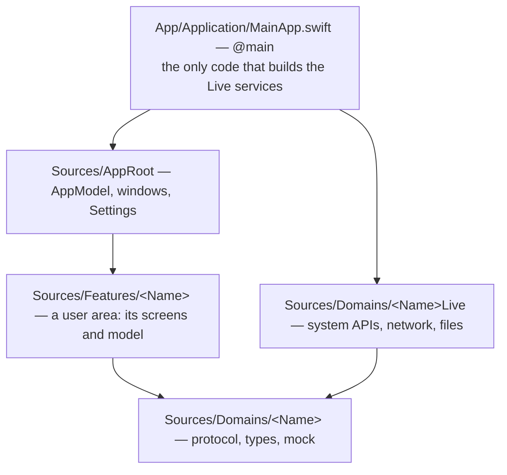
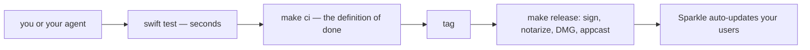

# macOS SwiftUI app template, built for coding agents

Ship a native macOS app with the boring parts done and the structure enforced: `swift
test` runs unit and render tests in seconds without building the app; a new feature or
domain needs zero Xcode project edits; a feature cannot import a live service, so tests
and previews run on mocks; a pushed tag ships a signed, notarized DMG that updates your
users through Sparkle. One entry point — `make` — shared by people and agents.

## How it is organized

One rule holds it together: a feature never imports a Live target — the build rejects
it — so every test and preview runs on mocks, and `swift test` builds no app, no Xcode.
Why each layer exists: [docs/ARCHITECTURE.md](docs/ARCHITECTURE.md).

## The daily loop

## For / not for

| For | Not for |
| --- | --- |
| a native macOS app, small to medium, built by one person or an agent | iOS, cross-platform, or a large team with its own conventions |

## What you get

| Mechanism | What it buys you |
| --- | --- |
| all code in one Swift package | `swift test` in seconds; any editor understands the project |
| a thin Xcode shell: buildable folders, settings in `App/Configs/*.xcconfig` | a feature or domain joins without touching `project.pbxproj` |
| `make lint` enforces the layering: services come in through `init`, mocks in tests | an agent cannot quietly wire a screen to the real system |
| every screen rendered light and dark by a render test | CI uploads the images; a broken layout is seen, not guessed |
| Swift 6 language mode, warnings as errors, lefthook, pinned toolchain | what compiles is clean; `make ci` is the same gate CI runs |
| release-please plus a one-time release setup | a tag ships a notarized DMG, appcast and changelog |
| eight skills ([`.agents/skills/`](.agents/skills)) | the agent knows the big moves: a feature, the icon, the DMG, the release setup, a Mac App Store build, a Homebrew cask |
| string catalogs enforced per `REQUIRED_LOCALES`, sandbox, privacy manifest, Icon Composer icon | the parts every App Store review asks for, done |

## Start

1. Click **Use this template** on GitHub and clone your new repository.
2. `make setup` — checks the toolchain and installs the git hooks.
3. Open it in your agent and say **initialize the app**: it asks for the name, bundle id
   and the rest, shows what will change, and commits. Removing the Notes demo — a small
   worked example of a feature — is one of its options.
4. `make ci` — green means your app builds, passes its tests and launches.
5. Ask the agent for your first feature. `make help` lists everything; `make run` starts
   the app.

Day-to-day commands and editors: [docs/DEVELOPMENT.md](docs/DEVELOPMENT.md).

## Prerequisites

| Need | Why |
| --- | --- |
| A Mac with Xcode 26.2, the version CI uses | Swift 6.2 compiler (Swift 6 language mode); the app runs on macOS 14+ |
| `sudo xcodebuild -runFirstLaunch` | Xcode's first-launch tasks, once |
| `brew install lefthook gh`, then `gh auth login` | git hooks; GitHub for init and pull requests |
| A coding agent that reads `AGENTS.md` | Claude Code, Codex, Cursor or similar |

## Contributing

Changes to the template are welcome: [CONTRIBUTING.md](.github/CONTRIBUTING.md).
Report security issues privately: [SECURITY.md](.github/SECURITY.md).

## License

[MIT](LICENSE)
