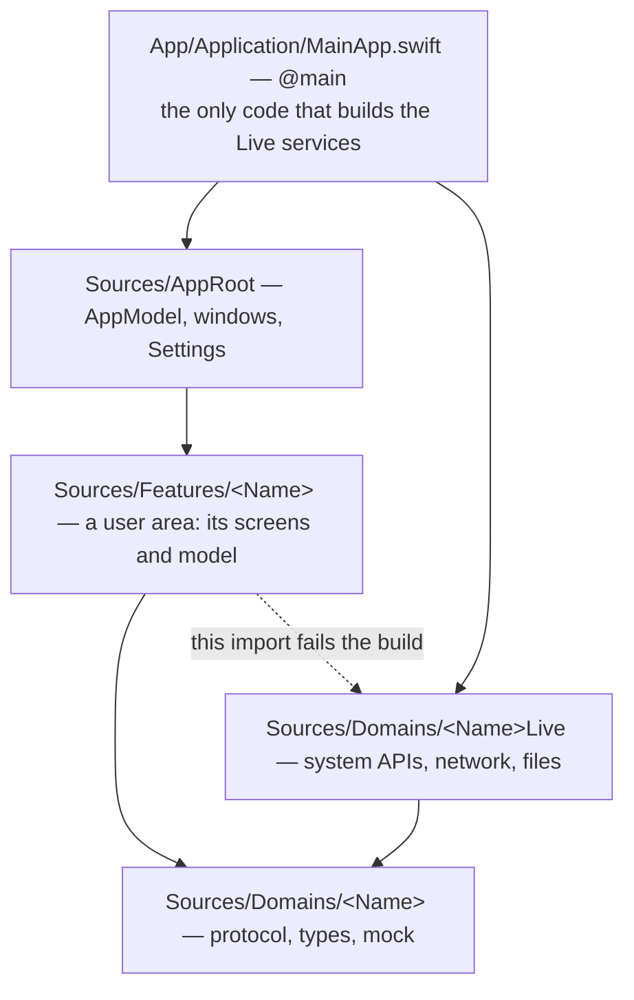
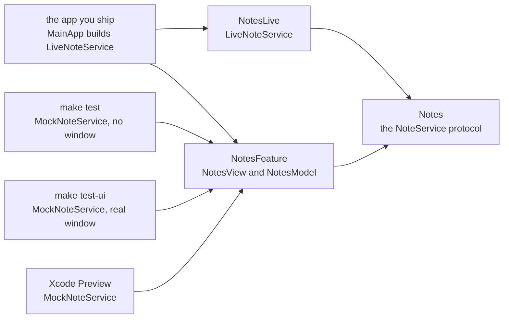

# macOS SwiftUI app template, built for coding agents

[](https://github.com/chengzi-io/macos-swiftui-spm-template/actions/workflows/ci.yml)


[](LICENSE)

**English** | [简体中文](README.zh-CN.md)

A native macOS app an agent can work in on the first day. The code is one Swift package, so
`swift test` builds and tests it in seconds without Xcode, and a new feature or domain joins
without an edit to the Xcode project. Features import protocols only, so tests, previews and
UI tests run on mocks. Shipping a version takes one workflow run that builds a signed DMG
and feeds Sparkle, and each step of the way is a `make` target.

It is for one person working with a coding agent on a macOS app of small to medium size. It
is not for iOS, cross-platform code, or a team that already has its own module conventions.

## What you get

| Mechanism | What it buys you |
| --- | --- |
| all code in one Swift package | `swift test` builds it in seconds, without Xcode; Xcode builds the same package for the app |
| a thin Xcode shell: `App/` holds the `@main`, the assets, the entitlements and `Configs/*.xcconfig` | the identity and every setting live in files a diff can read; a feature, a module or a setting joins without a `project.pbxproj` conflict |
| `make lint` checks the layering and the APIs everyone reaches for by habit | a feature cannot import a live service; `@AppStorage`, `print`, `Date()`, `try!` and `static let shared` fail the lint |
| a render test draws every screen, light and dark | a broken layout shows in `.build/renders/`, and CI keeps the images of each run |
| XCUITests that launch the app with `UI_TESTING=1`, so it runs on mocks | `make test-ui` drives the real windows without touching the network, the disk or the clock |
| Swift 6 language mode, warnings as errors, a lefthook pre-commit hook, `.xcode-version` | what compiles is clean, and `make ci` runs the same gate as CI |
| colors defined in code, `AccentColor` left empty | `swift test` copies an asset catalog without compiling it, so a render test can draw only a color that code defines; an empty accent keeps the user's own |
| string catalogs checked per language, sandbox, privacy manifest, Icon Composer icon, Settings scene | the parts macOS asks an app for are wired already |
| a `Release` workflow and Sparkle | one **Run workflow** builds, signs and drafts a DMG; you test the draft, click **Publish release**, and installed copies update themselves |
| three skills in the repository | setup, a new feature, and one recipe per capability the template leaves out |

## What a feature looks like

`make feature NAME=Monitor` writes the target, the scheme entry, the string catalog and a
render test, then prints the two lines that wire it in:

```swift
// Sources/AppRoot/AppModel.swift, beside the other feature models
public let monitor = MonitorModel()

// Sources/AppRoot/AppScenes.swift, in the scene that shows it
MonitorView(model: model.monitor)
```

A service the feature needs arrives through `init`, with its protocol and mock in a domain
Core and its live implementation in the matching Live. `MainApp` in `App/Application/` is
the composition root: it builds the live services, and nothing else does.

## How it is organized



One folder is one target with one job, and every arrow points one way. The dotted arrow is
the one the compiler refuses: a feature that imports a live service does not build. Why each
layer exists: [docs/ARCHITECTURE.md](docs/ARCHITECTURE.md).

## One feature, four launchers



The feature code is the same in all four cases; only the service at the other end of the
protocol changes. That is why `make test` takes seconds, why a preview needs no fixtures, and
why a UI test never touches the disk.

## Requirements

| Need | Why |
| --- | --- |
| a Mac with Xcode 26.2, the version CI uses | the Swift 6.2 compiler and Icon Composer it ships; the app itself runs on macOS 14+ ([docs/TOOLCHAIN.md](docs/TOOLCHAIN.md)) |
| `sudo xcodebuild -runFirstLaunch`, once | finishes Xcode's first-launch tasks |
| `brew install lefthook gh`, then `gh auth login` | the git hooks; GitHub for the repository and the release |
| a coding agent that reads `AGENTS.md` | Claude Code, Codex, Cursor or similar |

## Start

1. Click **Use this template** on GitHub and clone the new repository.
2. `make setup` checks the toolchain and installs the git hooks.
3. `make status` says where the project stands, and its `next:` line names the step to take:
   the app's name and bundle id, then the icon, then the first release. Ask your agent to do
   that step; for the first one a skill in the repository asks you for the values, shows you
   each file it would write, and writes them once you agree.

Your first feature takes the place of the demo, a Notes window and a Settings window.
`make help` lists the targets; `make run` starts the app.

## Skills

Three skills ship with the repository: project setup, a new feature, and one recipe per
capability the template leaves out (networking, Keychain, SwiftData, a menu bar item, AppKit
bridges and others). An agent reads them in that order.

The icon, a designed DMG window, Developer ID signing and a Homebrew cask are skills in the
[chengzi-io/skills](https://github.com/chengzi-io/skills) **macos** plugin, outside this
repository. Start each one yourself:

```bash
claude plugin marketplace add chengzi-io/skills
claude plugin install macos@chengzi-skills -s project
# also: grok plugin install macos --trust
#        codex plugin add macos@chengzi-skills
```

| Skill | What it does |
| --- | --- |
| `macos-app-icon` | an Icon Composer `.icon` from a logo, drawn layers or an image prompt |
| `macos-dmg-window` | a designed DMG window, built with dmgbuild |
| `macos-developer-id` | the Developer ID certificate, notary key and signing secrets |
| `macos-homebrew` | the official `homebrew/cask`, or your own tap updated by each release |

## Docs

| File | Read it for |
| --- | --- |
| [docs/ARCHITECTURE.md](docs/ARCHITECTURE.md) | why the layers are split this way |
| [docs/DEVELOPMENT.md](docs/DEVELOPMENT.md) | the daily commands, editors, and where code goes |
| [docs/TOOLCHAIN.md](docs/TOOLCHAIN.md) | the pinned Xcode and Swift, and how to upgrade them |
| [docs/RELEASING.md](docs/RELEASING.md) | a release, the first one included |
| [.github/CONTRIBUTING.md](.github/CONTRIBUTING.md) | commit and PR titles, the PR flow |

## License

[MIT](LICENSE)
