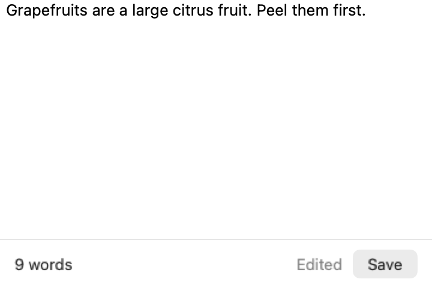
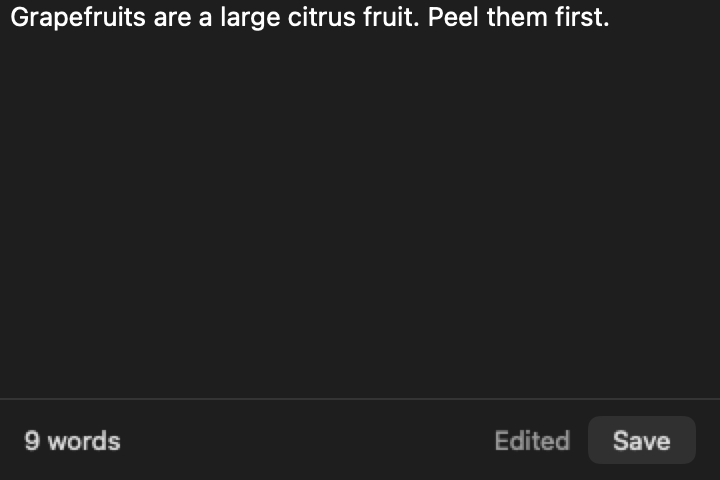

# macOS SwiftUI SPM Template

A macOS SwiftUI app template for building with coding agents: all code in a Swift
package, a thin Xcode shell, `make` as the one entry point, and releases that ship a DMG
and update through Sparkle.

| Light | Dark |
| --- | --- |
|  |  |

The Notes demo, drawn by its render test. Init can remove it.

## What you get

| Area | In the box |
| --- | --- |
| Code | One Swift package: features, domains split into Core and Live, `AppRoot` ([why](docs/ARCHITECTURE.md)) |
| Rules | [AGENTS.md](AGENTS.md) for agents; Swift 6 language mode, warnings as errors, `make lint` |
| Tests | Swift Testing, light and dark renders of every screen, XCUITests on CI |
| Releases | release-please, Developer ID or ad-hoc signing, notarization, Sparkle 2 ([flow](docs/RELEASING.md)) |
| App basics | App Sandbox, English and Simplified Chinese strings, privacy manifest, Icon Composer icon |

## Prerequisites

| Need | Why |
| --- | --- |
| A Mac with Xcode 26.2, the version CI uses | Swift 6.2 compiler (Swift 6 language mode); the app runs on macOS 14+ |
| `sudo xcodebuild -runFirstLaunch` | Xcode's first-launch tasks, once |
| `brew install lefthook gh`, then `gh auth login` | git hooks; GitHub for init and pull requests |
| A coding agent that reads `AGENTS.md` | Claude Code, Codex, Cursor or similar |

## Start

1. Click **Use this template** on GitHub and clone your new repository.
2. Open it in your agent and say **initialize the app**. The agent asks for the name and
   the rest, shows what will change, and commits it.
3. Run `make ci`: green means your app builds, passes its tests and launches.
4. Ask the agent to add your first feature, then to replace the Notes demo.

Day-to-day commands and editors: [docs/DEVELOPMENT.md](docs/DEVELOPMENT.md).

## Contributing

Changes to the template are welcome: [CONTRIBUTING.md](.github/CONTRIBUTING.md).
Report security issues privately: [SECURITY.md](.github/SECURITY.md).

## License

[MIT](LICENSE)
