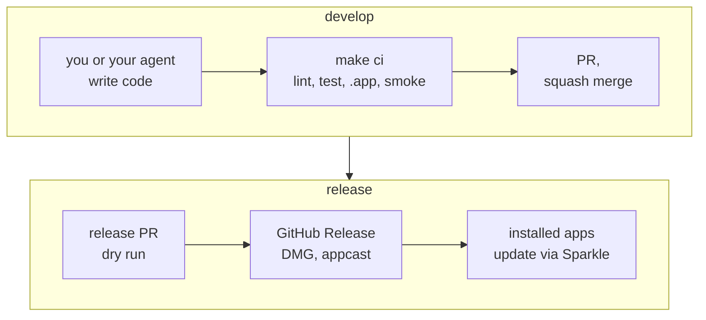
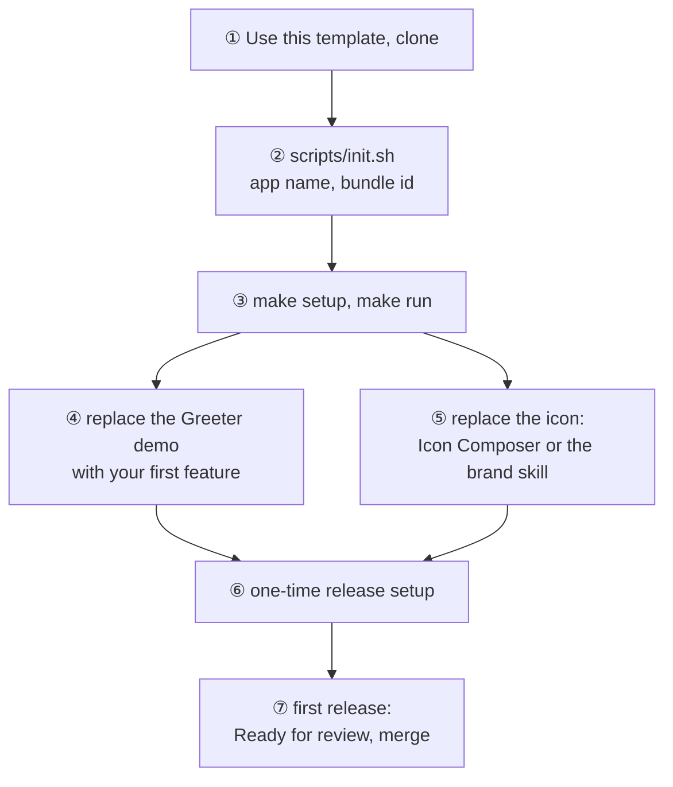

# macos-swiftui-spm-template

A macOS SwiftUI app template made for building with coding agents: a pure
`Package.swift` with no `.xcodeproj`, one `make` entry point, the rules in
[AGENTS.md](AGENTS.md), and a release pipeline that turns a merged PR into a signed DMG
that installed copies update to.



## What you get

- A SwiftUI app in a Swift package: `App` (entry point, scenes, updater) and `AppCore`
  (views, models, services), tested with Swift Testing.
- Swift 6 language mode, MainActor by default, warnings as errors.
- `.app` packaging with no Xcode project: xcodebuild compiles the package, including
  asset and string catalogs; `scripts/build-app.sh` assembles, signs and verifies the
  bundle.
- App Sandbox; Developer ID signing, hardened runtime and notarization — or ad-hoc
  signing until you have a Developer ID.
- Sparkle 2 updates from GitHub Releases, EdDSA-signed.
- English and Simplified Chinese string catalog, privacy manifest, accent color, and an
  Icon Composer app icon: Liquid Glass on macOS 26, flattened images on macOS 14–15.
- Agent skills: `brand` writes a brand brief and icon layers for Icon Composer; `dmg`,
  started by you only, designs an optional DMG window.
- `make ci`: `swift format` lint, unit tests, debug `.app`, launch smoke test.
- GitHub: CI on macOS runners, PR title check, release-please versioning and
  CHANGELOG, a release dry run before tagging, and a publish job that checks and
  uploads the DMG, dSYM, appcast and checksums before publishing. Dependabot. Optional
  Homebrew cask and Mac App Store package.

## Start a new app



Steps ①, ⑥ and ⑦ need your GitHub and Apple accounts; your agent can do ② to ⑤. You
need Xcode 26 (Swift 6.2) and `brew install lefthook`; the app runs on macOS 14 or
later.

```bash
scripts/init.sh --name MyApp --bundle-id com.example.myapp \
  --display-name "My App" --copyright "Jane Doe"
make setup   # check the toolchain, install git hooks
make run     # build and launch the debug app
```

`scripts/init.sh` writes the app identity into `Bundle/app.env`, points releases and
updates at your repository, resets the version to `0.0.0`, updates LICENSE, CODEOWNERS
and the issue templates, and replaces this README with a short page for your app's
users. It removes the template's own planning docs, then itself.

With an agent: open the repository in Claude Code, Codex or another agent that reads
`AGENTS.md`, and describe the app. Before init has run, the agent asks for the name and
bundle identifier and runs it first; then it builds features the way `AGENTS.md` sets
out and finishes each with `make ci`.

## Docs

| File | What it covers | After init |
| --- | --- | --- |
| `README.md` | this page | replaced by your app's page |
| `AGENTS.md` (`CLAUDE.md` points to it) | rules for agents, where code goes | kept |
| [docs/DEVELOPMENT.md](docs/DEVELOPMENT.md) | setup, commands, layout, how the app is built | kept |
| [docs/RELEASING.md](docs/RELEASING.md) | the release flow, one-time setup, recovery | kept |
| [docs/RECIPES.md](docs/RECIPES.md) | launch at login, networking, menu bar, crash reporting | kept |
| `docs/TEMPLATE-PLAN.md`, `docs/ACCEPTANCE.md` | the template's own plan and checks (Chinese) | removed |

## License

[MIT](LICENSE)
