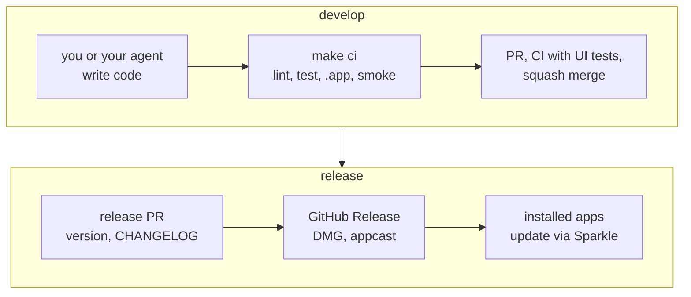
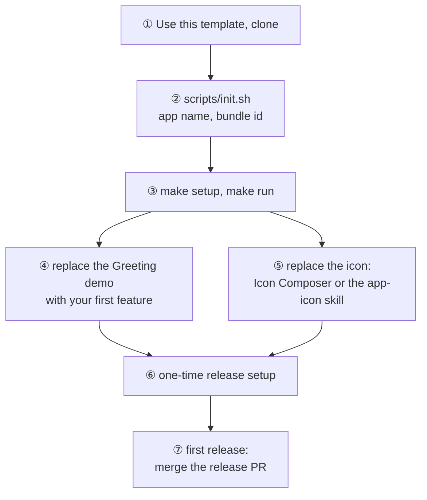

# macos-swiftui-spm-template

A macOS SwiftUI app template made for building with coding agents: a thin Xcode
project around a local Swift package that holds all the code, one `make` entry point,
the rules in [AGENTS.md](AGENTS.md), and a release pipeline that turns a merged PR into
a signed DMG that installed copies update to.



## What you get

- A thin `App.xcodeproj`: the app target (`@main`, assets, icon) and a UI test target,
  both buildable folders, with every build setting in `Configs/*.xcconfig`. Agents add
  files without touching the project file.
- All code in the local package `Packages/AppModules`, one target per layer: `AppRoot`,
  a target per feature, `Services` (protocols and mocks) and `ServicesLive` (system
  APIs, network, Sparkle). The compiler keeps features away from live services.
- Swift 6 language mode, MainActor by default in UI targets, warnings as errors in the
  package and the app, and `make lint` rules against APIs agents reach for out of
  habit.
- App Sandbox; Developer ID signing, hardened runtime and notarization — or ad-hoc
  signing until you have a Developer ID.
- Sparkle 2 updates from GitHub Releases, EdDSA-signed.
- English and Simplified Chinese string catalog, privacy manifest, accent color, and an
  Icon Composer app icon: Liquid Glass on macOS 26, flattened images on macOS 14–15.
- Agent skills: `app-icon` makes the Liquid Glass icon from your logo, drawn layers or
  an image-model prompt, and checks it in every appearance beside apps in your Dock.
  Skills you start yourself add what not every app needs: `dmg` designs the DMG window,
  `mac-app-store` adds an App Store build, `homebrew-cask` puts the app on Homebrew,
  in the official repository or your own tap.
- `make test` (unit tests in seconds) and `make ci`: lint, unit tests, debug `.app`,
  launch smoke test. `make test:ui` runs the XCUITests, which take over the mouse and
  keyboard, so GitHub CI runs them.
- GitHub: CI on macOS runners (including the UI tests), PR title check, release-please versioning and
  CHANGELOG, and a publish job that checks the DMG, dSYM, appcast and checksums and
  uploads them to a draft release before publishing it. Dependabot.

## Start a new app



Steps ①, ⑥ and ⑦ need your GitHub and Apple accounts; your agent can do ② to ⑤. You
need Xcode 26 (Swift 6.2) and `brew install lefthook`; the app runs on macOS 14 or
later.

```bash
scripts/init.sh --name MyApp --bundle-id com.example.myapp \
  --display-name "My App" --copyright "Jane Doe"
make setup   # check the toolchain, install git hooks
make run     # build and launch the debug app
```

`scripts/init.sh` writes the app identity into `Configs/Identity.xcconfig`, points releases and
updates at your repository, resets the version to `0.0.0`, updates LICENSE, CODEOWNERS
and the issue templates, and replaces this README with a short page for your app's
users. It removes the template's own planning docs, then itself.

With an agent: open the repository in Claude Code, Codex or another agent that reads
`AGENTS.md`, and describe the app. Before init has run, the agent asks for the name and
bundle identifier and runs it first; then it builds features the way `AGENTS.md` sets
out and finishes each with `make ci`.

## Docs

| File | What it covers | After init |
| --- | --- | --- |
| `README.md` | this page | replaced by your app's page |
| `AGENTS.md` (`CLAUDE.md` points to it) | rules for agents, where code goes | kept |
| [docs/DEVELOPMENT.md](docs/DEVELOPMENT.md) | setup, commands, layout, how the app is built | kept |
| [docs/RELEASING.md](docs/RELEASING.md) | the release flow, one-time setup, recovery | kept |
| [docs/RECIPES.md](docs/RECIPES.md) | launch at login, networking, menu bar, crash reporting | kept |
| `docs/TEMPLATE-PLAN.md`, `docs/ACCEPTANCE.md` | the template's own plan and checks (Chinese) | removed |

## License

[MIT](LICENSE)
