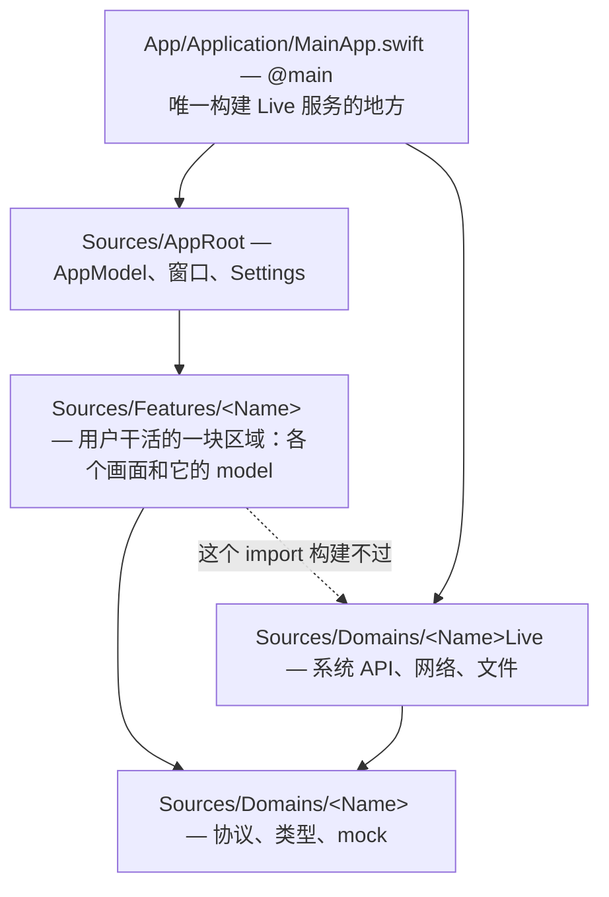
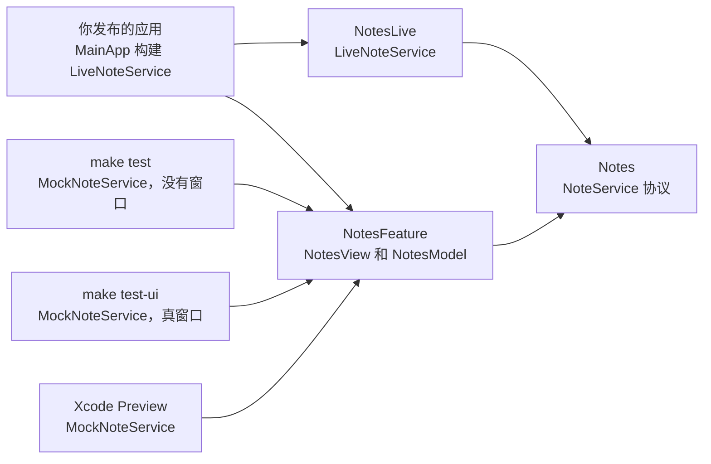

# macOS SwiftUI 应用模板，为编程 agent 打造

[](https://github.com/chengzi-io/macos-swiftui-spm-template/actions/workflows/ci.yml)


[](LICENSE)

[English](./README.md) | **简体中文**

一个第一天就能让 agent 上手干活的 macOS 原生应用。代码是一个 Swift 包，所以 `swift test` 不用
Xcode、几秒内就能构建并跑完测试；加一个 feature 或一个领域，不用改 Xcode 工程。feature 只
import 协议，所以测试、Preview 和 UI 测试都跑在 mock 上。发一个版本就是跑一次 workflow：构建
签名好的 DMG，再喂给 Sparkle。一路上每一步都是一个 `make` 目标。

它面向一个人加一个编程 agent，做中小规模的 macOS 应用。不适合 iOS、跨平台代码，也不适合已经有
自己模块约定的团队。

## 换来什么

| 机制 | 换来什么 |
| --- | --- |
| 所有代码在一个 Swift 包里 | `swift test` 不用 Xcode、几秒内构建完；Xcode 构建的是同一个包，用来出应用 |
| 一个很薄的 Xcode 壳：`App/` 里只有 `@main`、资源、entitlements 和 `Configs/*.xcconfig` | 身份和每一项设置都待在 diff 看得懂的文件里；加 feature、加模块、加设置都不会在 `project.pbxproj` 上冲突 |
| `make lint` 检查分层，也检查顺手就会写出来的 API | feature 没法 import live 服务；`@AppStorage`、`print`、`Date()`、`try!` 和 `static let shared` 过不了 lint |
| 渲染测试把每个画面明暗各画一遍 | 布局坏了在 `.build/renders/` 里看得见，CI 也留着每次运行的图 |
| XCUITests 带 `UI_TESTING=1` 启动应用，所以跑在 mock 上 | `make test-ui` 操作的是真窗口，却不碰网络、磁盘和时钟 |
| Swift 6 语言模式、警告当错误、lefthook 提交前钩子、`.xcode-version` | 编译得过就是干净的，`make ci` 跑的和 CI 是同一道门 |
| 颜色写在代码里，`AccentColor` 留空 | `swift test` 只拷贝 asset catalog 不编译它，所以渲染测试只画得出代码里定义的颜色；强调色留空，用户自己的设置才生效 |
| 按语言检查的 string catalog、沙盒、隐私清单、Icon Composer 图标、Settings 场景 | macOS 要求应用有的那些东西已经接好了 |
| 一个 `Release` workflow 加 Sparkle | 点一次 **Run workflow** 就构建、签名并留下草稿；你验收草稿、点 **Publish release**，已安装的副本自己更新 |
| 仓库里带三个 skill | 建项目、加 feature、以及模板没做的那项能力，各有一份 |

## 加一个 feature 是什么样子

`make feature NAME=Monitor` 会写好 target、scheme 条目、string catalog 和渲染测试，然后打印把
它接进去的两行：

```swift
// Sources/AppRoot/AppModel.swift，和其他 feature 的 model 放在一起
public let monitor = MonitorModel()

// Sources/AppRoot/AppScenes.swift，在显示它的那个 scene 里
MonitorView(model: model.monitor)
```

feature 需要的服务从 `init` 进来：协议和 mock 在领域 Core 里，真实实现放在对应的 Live 里。
`App/Application/` 里的 `MainApp` 是组装点，live 服务只由它构建，别处不构建。

## 结构



一个文件夹就是一个 target、一件事，箭头只朝一个方向。虚线的那个箭头是编译器拒绝的：feature
一旦 import live 服务就构建不过。每一层为什么存在：[docs/zh/ARCHITECTURE.md](docs/zh/ARCHITECTURE.md)。

## 一个 feature，四种启动方式



四种情况下 feature 的代码是同一份，变的只是协议另一头的那个服务。所以 `make test` 只要几秒，
Preview 不用造数据，UI 测试也碰不到磁盘。

## 需要什么

| 需要 | 为什么 |
| --- | --- |
| 一台装了 Xcode 26.2 的 Mac，也就是 CI 用的那个版本 | 它带的 Swift 6.2 编译器和 Icon Composer；应用本身跑在 macOS 14+（[docs/zh/TOOLCHAIN.md](docs/zh/TOOLCHAIN.md)） |
| `sudo xcodebuild -runFirstLaunch`，一次 | 走完 Xcode 首次启动的那些事 |
| `brew install lefthook gh`，然后 `gh auth login` | git 钩子；GitHub 用来建仓库和发版 |
| 一个会读 `AGENTS.md` 的编程 agent | Claude Code、Codex、Cursor 之类 |

## 开始

1. 在 GitHub 上点 **Use this template**，把新仓库 clone 下来。
2. `make setup` 检查工具链，装好 git 钩子。
3. `make status` 说清项目走到哪了，它的 `next:` 行点名下一步：应用的名字和 bundle id，然后是
   图标，然后是第一次发版。让 agent 去做那一步；第一步由仓库里的 skill 问你要这些值，把每个
   要写的文件先给你看，你点头才写。

你的第一个 feature 会顶掉演示用的 Notes 窗口和 Settings 窗口。`make help` 列出各个目标；
`make run` 启动应用。

## Skill

仓库里带三个 skill：建项目、加 feature，以及模板没做的那项能力每个一份配方（网络、Keychain、
SwiftData、菜单栏项、AppKit 桥接等）。agent 按这个顺序读。

图标、设计过的 DMG 窗口、Developer ID 签名和 Homebrew cask 是
[chengzi-io/skills](https://github.com/chengzi-io/skills) 的 **macos** 插件里的 skill，不在这个
仓库里。每一个都由你自己启动：

```bash
claude plugin marketplace add chengzi-io/skills
claude plugin install macos@chengzi-skills -s project
# also: grok plugin install macos --trust
#        codex plugin add macos@chengzi-skills
```

| Skill | 做什么 |
| --- | --- |
| `macos-app-icon` | 从 logo、画好的图层或一句图像提示，做出 Icon Composer 的 `.icon` |
| `macos-dmg-window` | 用 dmgbuild 做一个设计过的 DMG 窗口 |
| `macos-developer-id` | Developer ID 证书、公证 key 和签名用的 secret |
| `macos-homebrew` | 官方 `homebrew/cask`，或者每次发版都更新的自己的 tap |

## 文档

| 文件 | 读它做什么 |
| --- | --- |
| [docs/zh/ARCHITECTURE.md](docs/zh/ARCHITECTURE.md) | 为什么这样分层 |
| [docs/zh/DEVELOPMENT.md](docs/zh/DEVELOPMENT.md) | 日常命令、编辑器、代码放哪 |
| [docs/zh/TOOLCHAIN.md](docs/zh/TOOLCHAIN.md) | 固定的 Xcode 和 Swift 版本，以及怎么升级 |
| [docs/zh/RELEASING.md](docs/zh/RELEASING.md) | 怎么发版，包括第一次 |
| [.github/CONTRIBUTING.md](.github/CONTRIBUTING.md) | commit 和 PR 标题，PR 流程 |

## 许可证

[MIT](LICENSE)
