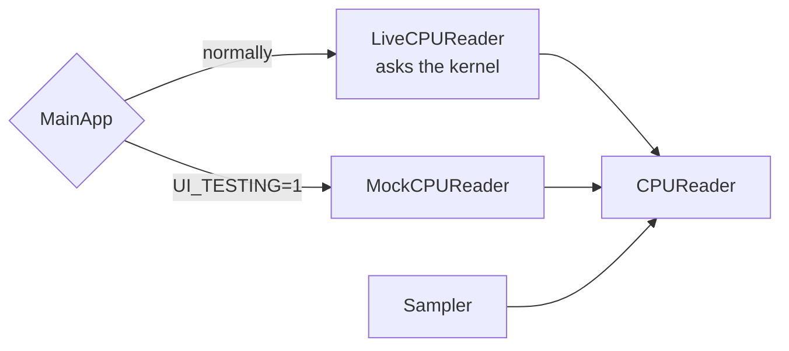
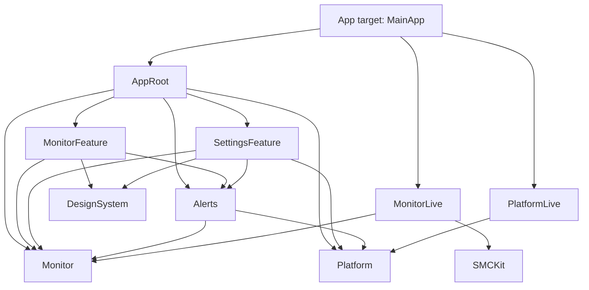
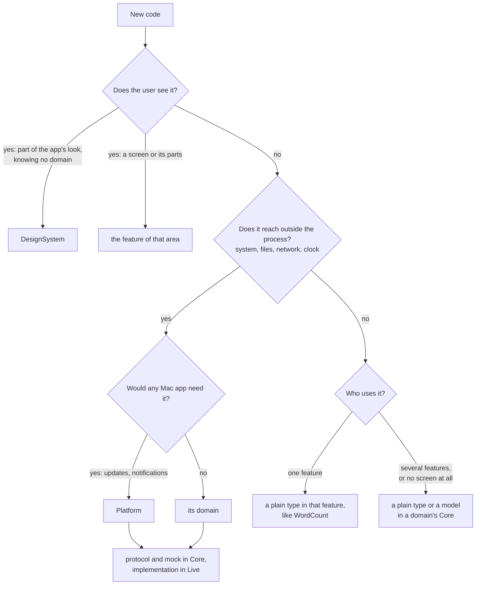
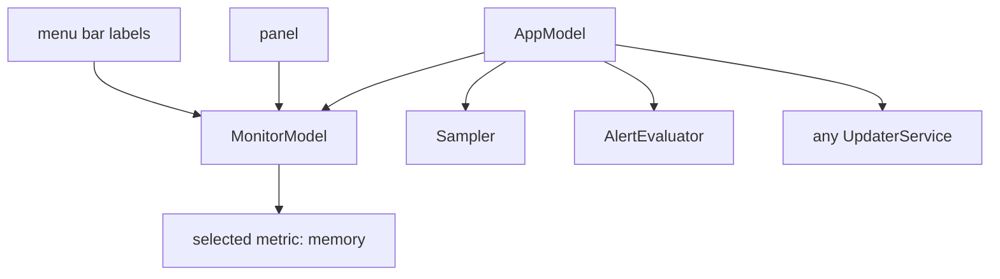
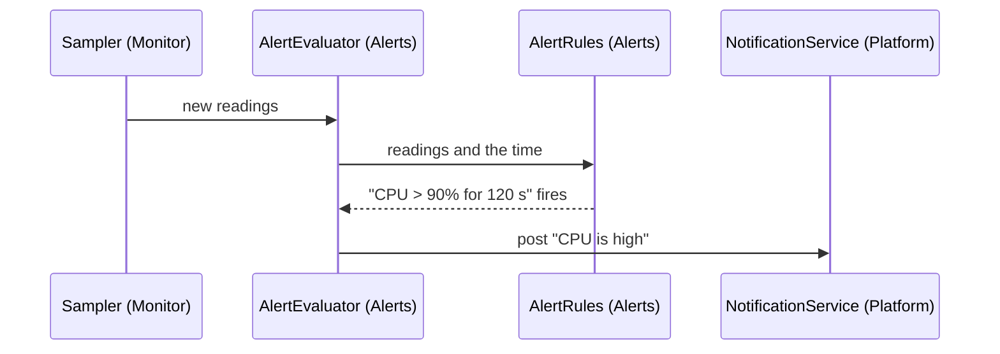

# Architecture

How the code is split, why, and where a new piece goes. The rules are in
[AGENTS.md](../AGENTS.md); this page explains them with one example, a menu bar system
monitor, the size of app the structure is for.

## The pieces

| Piece | What it holds | In the monitor |
| --- | --- | --- |
| Feature | an area the user works in: its screens and their model | `MonitorFeature`: menu bar labels, panels |
| Domain Core | what the app is about: protocols for what is outside the process, value types, pure logic, shared models, mocks | `Monitor`: `CPUReader`, `Sampler`; `Alerts` |
| Domain Live | the real implementations of those protocols | `MonitorLive`: asks the kernel |
| Platform | what any Mac app needs: updates, launch at login, notifications | `UpdaterService`, `NotificationService` |
| DesignSystem | the app's look: the spacing, radii, fonts and colors it repeats, and shared components; knows no domain | `Spacing`, `StatusLevel` colors, `Sparkline` |
| Kit | code that knows nothing of the app | `SMCKit` |
| AppRoot | the root model and the scenes | `AppModel`, `AppScenes`, the status items |
| MainApp | in the Xcode target: builds the live services and hands them to AppRoot | the live readers, or mocks |

## One rule holds it together

Features see protocols; only `MainApp`, in the Xcode target, builds the live
implementations.



- Tests and previews run the same code against a mock; nothing asks the kernel.
- A feature cannot create a `LiveCPUReader`: it does not depend on `MonitorLive`, so
  `make test` fails on the import.
- An App Store build and a direct build choose their updater in their own `MainApp`. A
  package target cannot see which Xcode target builds it, so the choice stays there.

## The monitor, laid out

```text
Sources/
  AppRoot/                 AppModel, AppScenes, StatusItems (an NSStatusItem per metric)
  Features/
    Monitor/               MonitorFeature: MonitorModel (the selected metric)
      MenuBar/             the label in each status item: value, sparkline
      Panel/               a panel per metric: value, five-minute chart, details
      Overview/            every metric on one screen
    Settings/              SettingsFeature: General, Alerts and Updates tabs
  DesignSystem/            Spacing, Radius, Font.metricValue, StatusLevel and its colors,
                           StatusBadge, Sparkline
  Monitor/
    Core/                  Monitor: what the Mac reports
      Sampling/            Sampler (one timer, the latest readings, an hour of history)
      CPU/                 CPUReader, CPUTicks, CPUUsage.compute, MockCPUReader
      Memory/  Network/  Disk/  Battery/  Sensors/
    Live/                  MonitorLive
      CPU/                 LiveCPUReader (host_processor_info)
      Memory/  Network/  Disk/  Battery/
      Sensors/             LiveFanReader, through SMCKit
  Alerts/
    Core/                  Alerts: AlertRule, AlertRules (when a rule fires), AlertEvaluator
  Platform/
    Core/                  UpdaterService, LaunchAtLoginService, NotificationService
    Live/                  PlatformLive
  Kits/
    SMCKit/                AppleSMC's C interface in Swift; knows nothing of the monitor
Tests/
  Features/MonitorTests/  Features/SettingsTests/  MonitorTests/  AlertsTests/
App/Application/           MainApp: the live readers, or mocks under UI_TESTING=1
```

Ten library targets. CPU, memory and network are folders, not targets. `Alerts` has no
Live: the one thing it needs from outside, notifications, is `Platform`'s. The app
target links one product, `AppModules`, which lists every module `MainApp` imports:
`AppRoot`, `Monitor`, `MonitorLive`, `Alerts`, `Platform`, `PlatformLive`.



## Where does this code go?



A wrapper of a C or private interface that knows nothing of the app, such as SMC, is a
kit; a Live uses it.

## Cases

### Several screens show the same data

The menu bar label, the panel and the overview show the same readings and change
together: a new refresh interval or unit touches all three. They are one target,
`MonitorFeature`, with a folder per screen. As three targets, each would need its own
test target and a line in `AppRoot`'s dependencies, `AppModel` would hold three models,
and they could share the selected metric only through `AppModel`.

A target splits when part of it changes for other reasons: Settings changes with what
can be configured, so it is a feature of its own. Its panes set what the app (launch at
login, updates) and the domains (alert rules, the sample interval) keep. A pane that
needs one feature's own views, such as a preview of the menu bar label, is that
feature's `MonitorSettingsView`: Settings cannot import another feature, so `AppScenes`,
which sees them all, hands it to `SettingsView` beside the other panes. Change
`SettingsView` for that when the first such pane comes, not before.

### Two screens share state

Click the memory label and the panel shows memory. The selection belongs to
`MonitorModel`, the feature's model, which owns what its screens share.



`AppModel` holds the features' models, what a domain shares among features (the
`Sampler`, the `AlertEvaluator`) and what is app-wide (the updater). A new sensor
changes `Sampler` and `MonitorModel`, not `AppModel`.

### Something outside the process

`CPUReader` is a protocol in `Monitor` whose one call returns the kernel's CPU ticks;
`LiveCPUReader` in `MonitorLive` calls `host_processor_info`, and `MockCPUReader` beside
the protocol returns recorded ticks. Turning two readings into percentages,
`CPUUsage.compute`, is a plain function: tests call it with recorded ticks, and it gets
no protocol. `Sampler` calls the readers in the background (`@concurrent`) and stores
the results on the main actor, so every screen shows the same sample.

### One thing leads to another across domains

CPU above 90% for two minutes posts a notification. That is not the CPU reader's job,
nor a screen's. It belongs to `Alerts`, the domain that consumes the readings:



`Alerts` depends on the Cores of `Monitor` and `Platform`; `Monitor` does not know
`Alerts` exists, the evaluator subscribes to the sampler's readings. The decision,
`AlertRules`, is a plain type tested with made-up readings and times.

| Placed in | What goes wrong |
| --- | --- |
| `LiveCPUReader` | a test that fakes notifications must fake the CPU reader too, and each sensor repeats the rule |
| a screen's model | the rule runs only while that screen exists |
| `MainApp` | the shell holds business logic that a widget cannot share and no unit test reaches |
| an `AppCore` target for every flow | its name says nothing, so every flow lands there, and a feature that uses it reaches every domain and rebuilds when any of them changes |

A feature may depend on several domains: the panel shows readings and the alerts that
fired, so `MonitorFeature` depends on `Monitor` and `Alerts`. That is about showing; the
flow itself stays in `Alerts`.

### The app's look

The spacing, corner radii, fonts and colors the app picks for itself live in
`DesignSystem`, so every screen reads the same values: `Spacing.panel`,
`Font.metricValue` (monospaced digits, so a changing number does not jitter),
`StatusLevel.warning.color`. Components that several screens share live there too:
`StatusBadge(level:)`, which shows a level by shape and word as well as color, and
`Sparkline(values:)`. What the system already defines needs no token: `Form`,
`.font(.headline)`, `.secondary` and the controls' own spacing follow macOS, and a copy
of them would drift from it.

`DesignSystem` knows no domain. `MonitorFeature` maps `MemoryPressure.warning` to
`StatusLevel.warning`; a gauge that shows the current CPU reading stays in
`MonitorFeature`, because in `DesignSystem` it would make every screen depend on
`Monitor` and rebuild when a reading type changes.

Colors are written in code, a light and a dark value in one
`NSColor(name:dynamicProvider:)`, not in an asset catalog: `swift test` copies asset
catalogs without compiling them, so the render tests would draw those colors wrong.

The accent color is the exception. The system reads it from the app's asset catalog,
`AccentColor` in `App/Application/Assets.xcassets`, through `NSAccentColorName`, and
uses it only while the user's accent is multicolor; another choice of the user's wins.
The template leaves it empty, so the app follows the user's accent. `.tint` cannot
stand in for it: on macOS 15 it colors switches, prominent buttons, sliders and progress
bars but not checkboxes, the default button or links, and it would override the user's
choice. A brand color that the app's own views draw goes in `DesignSystem` as well, even
when it repeats the accent. The render tests draw outside the app and pin the accent to
blue, so they show the system's default, not the app's accent.

### A Live needs another domain

A Live uses its own Core, other domains' Cores and kits, never another Live, so a test
swaps one Live at a time. An `ExportLive` that writes readings to a CSV file uses
`Monitor`'s types, not `MonitorLive`. `scripts/lint-rules.sh` rejects `import …Live` in
a Live.

### A widget, or an App Store build

A widget is another thin target in `App/<Name>/` that links `Monitor` and the Live it
needs, never a feature or `AppRoot`, whose UI it cannot use; its views go in a package
target of their own. An App Store build is another app target whose `MainApp` builds no
Sparkle updater (the `mac-app-store` skill sets it up). Each target composes its own
services, which is why the composition stays in the Xcode target.

## Adding memory to the monitor

| | Files |
| --- | --- |
| New | `Monitor/Core/Memory/` (`MemoryReader`, `MemoryStats`, `MockMemoryReader`), `Monitor/Live/Memory/LiveMemoryReader.swift`, `Features/Monitor/Panel/MemoryPanel.swift` |
| Changed | `Sampler` reads memory too; `MonitorModel` can select it; `MainApp` passes the live or the mock reader to the `Sampler` |
| Unchanged | `Package.swift`, the Xcode project, `AppModel`, `AppScenes` |

## Not yet

| Idea | Why wait |
| --- | --- |
| a target per sensor | seven sensors become fourteen targets, and a new default interval touches half of them |
| a dependency injection container | the composition is one function in `MainApp` |
| several Swift packages | versions and resources must line up across them; worth it when one package builds too slowly |
| a widget target before a widget | an empty target to build and sign |
| a protocol for unit conversion | a pure function is tested directly |
| a token for every system value | macOS controls already have their fonts and spacing; tokens for them drift from the system |
