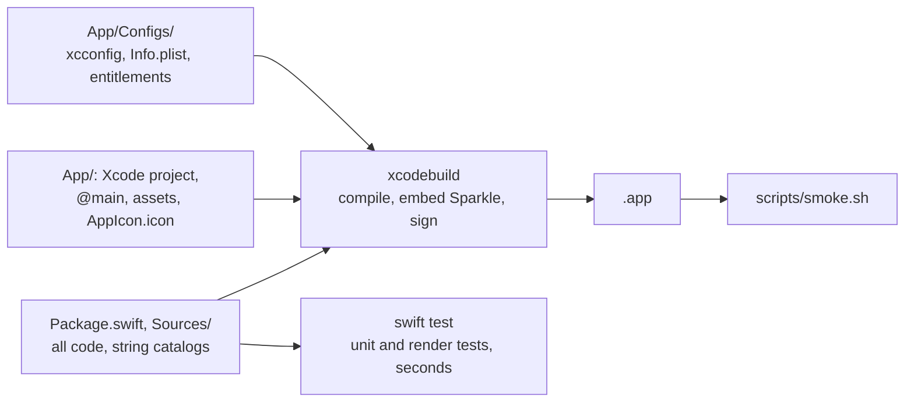
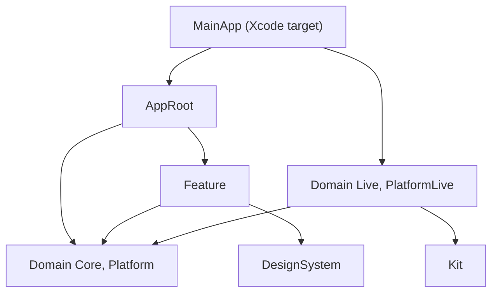
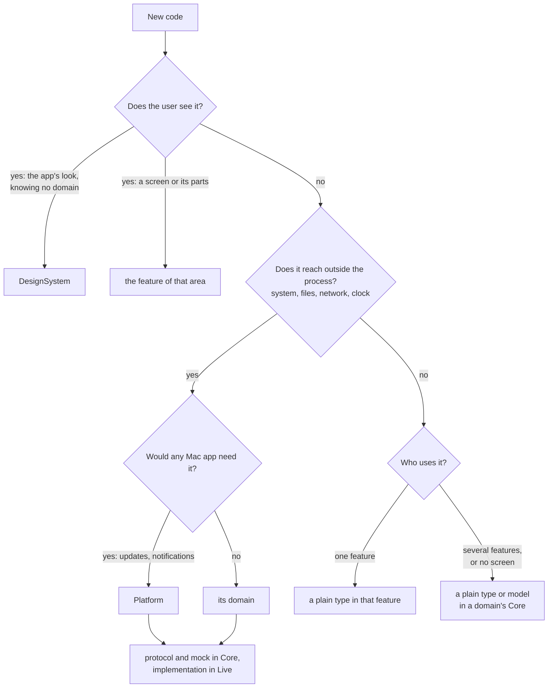
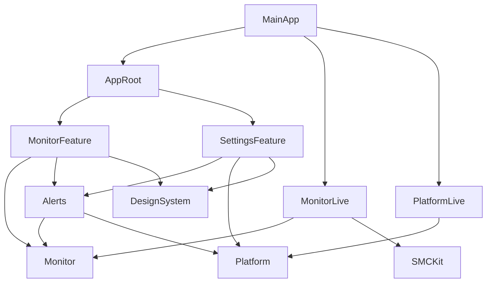

# Architecture

Why the code is split the way it is, for people reading the template. The rules agents
follow live in [Sources/AGENTS.md](../Sources/AGENTS.md) and [App/AGENTS.md](../App/AGENTS.md);
this page gives the reasons.

## How the app is built

| Why | Because |
| --- | --- |
| All code in one Swift package | `swift test` builds it without the app, so the test loop takes seconds; editors other than Xcode understand it |
| A thin Xcode project | only Xcode signs, embeds frameworks and compiles the icon; settings live in `App/Configs/*.xcconfig`, not the project |
| `scripts/build-app.sh` | adds the version from `version.txt` and, for releases, a universal archive signed with the Developer ID |

## Layers

| Layer | Holds | Depends on |
| --- | --- | --- |
| Feature | an area the user works in: screens and their model | domain Cores, Platform, DesignSystem |
| Domain Core | protocols for what is outside the process, value types, pure logic, mocks | other Cores, kits |
| Domain Live | the real implementations of a Core's protocols | its own Core, other Cores, kits; never another Live |
| Platform | what any Mac app needs: updates, launch at login, notifications | split into Core and Live like a domain |
| DesignSystem | spacing, radii, fonts, colors, shared components; knows no domain | nothing of the app |
| Kit | a wrapper of a C or private interface that knows nothing of the app | nothing of the app |
| AppRoot | the root model and the scenes | features, Cores |
| MainApp | in the Xcode target: builds the Lives and hands them to AppRoot | AppRoot, Lives |

## One rule holds it together

Features see protocols; only `MainApp` builds the live implementations.

| Effect | Why it matters |
| --- | --- |
| Tests and previews run against mocks | nothing touches the system, so tests are fast and repeatable |
| A feature cannot import a Live | it does not depend on one, so `make test` fails on the import |
| Each app target composes its own services | an App Store build picks no Sparkle updater in its own `MainApp`; a package target cannot see which target builds it |

## Where does this code go?

## A hypothetical example: a menu bar monitor

Not in the template: an imagined app of the size the structure is for, a monitor that
shows CPU, memory and network in the menu bar and alerts when CPU stays high.

| Question | Answer in the monitor | Why |
| --- | --- | --- |
| Menu bar label, panel and overview show the same readings | one `MonitorFeature`, a folder per screen | they change together; three targets would triple test targets and wiring |
| Settings | its own `SettingsFeature` | it changes with what can be configured, not with the readings |
| Clicking the memory label selects memory in the panel | the selection lives in `MonitorModel` | a feature's model owns what its screens share; `AppModel` only holds feature models and app-wide services |
| Reading the CPU | `CPUReader` protocol and mock in `Monitor`, `LiveCPUReader` in `MonitorLive` | tests feed recorded ticks; `CPUUsage.compute` is a plain function, no protocol |
| "CPU above 90% for two minutes" notifies | `AlertRules` in `Alerts`, which depends on `Monitor` and `Platform` | not in the reader (every sensor would repeat it), a screen (runs only while shown) or `MainApp` (no test reaches it) |
| Reading fans through SMC | `SMCKit`, used by `MonitorLive` | a kit knows nothing of the app |
| A widget | another thin target in `App/` linking `Monitor` and the Live it needs | it cannot use features or `AppRoot` |

Adding memory touches `Monitor/Core/Memory/`, `Monitor/Live/Memory/` and a panel, plus
`Sampler` and `MonitorModel`. `Package.swift`, the Xcode project and `AppModel` stay
unchanged.

## The app's look

| Thing | Where | Why |
| --- | --- | --- |
| Spacing, radii, fonts, colors the app picks | `DesignSystem` | every screen reads the same values |
| Shared components (`StatusBadge`, `Sparkline`) | `DesignSystem`, knowing no domain | a feature maps its types to them, so they do not rebuild on domain changes |
| Colors | code: one `NSColor(name:dynamicProvider:)` per color | `swift test` copies asset catalogs without compiling them, so renders would be wrong |
| Accent color | `AccentColor` in the app's asset catalog, empty by default | the system applies it only while the user's accent is multicolor; `.tint` would override the user |
| System fonts, spacing, `Form` | no token | a copy would drift from macOS |

## Not yet

| Idea | Why wait |
| --- | --- |
| A target per sensor or screen | seven sensors become fourteen targets, and one new interval touches half of them |
| A dependency injection container | the composition is one function in `MainApp` |
| Several Swift packages | versions and resources must line up; worth it only when one package builds too slowly |
| A widget target before a widget | an empty target to build and sign |
| A protocol for pure logic | a pure function is tested directly |
| A token for every system value | macOS controls already have their fonts and spacing |
