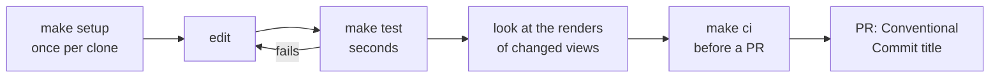

# Development

The daily loop, editors and commands, for people working on the app. Toolchain:
Xcode 26.2, the version CI uses ([TOOLCHAIN.md](TOOLCHAIN.md)); `make doctor` checks it.

## Daily loop

1. `make setup` once: checks the toolchain and installs the git hooks.
2. `make test` after every change. Its render tests draw each screen, light and dark,
   to `.build/renders/<test file>/<test>.png`. Nothing compares them: open the images
   of the views you changed.
3. `make ci` before you open a PR. It is the definition of done.
4. Open the PR with a Conventional Commit title
   ([CONTRIBUTING](../.github/CONTRIBUTING.md)); it is squash-merged and
   [released](RELEASING.md).

CI uploads the renders it draws on macOS 26 as the run's `renders` artifact:
`gh run download <run id> -n renders`.

## Commands

`make help` lists every target; these are the ones you use daily.

| Command | Does | When |
| --- | --- | --- |
| `make setup` | `make doctor`, then installs the git hooks | once per clone |
| `make doctor` | checks Xcode, tools and the signing identity | when a build fails oddly |
| `make test` | package unit tests and renders, no app | after every change |
| `make run` | builds and launches the debug app, logs in the terminal | to try a change |
| `make fmt` | formats Swift sources in place | before committing |
| `make lint` | formatting and `scripts/lint-rules.sh` | part of `make ci` |
| `make ci` | versions, lint, test, assets, app, smoke | before a PR |
| `make test:ui` | XCUITests; they take over the mouse and keyboard | when asked; CI runs them on every PR |
| `make logs` | streams the app's unified logs | while debugging |
| `make clean` | removes build output | after a toolchain change |

| Task | Command |
| --- | --- |
| Run in Chinese | `make run ARGS="-AppleLanguages '(zh-Hans)'"` |
| UI tests without a password prompt | `sudo automationmodetool enable-automationmode-without-authentication`, once |

## Editors

| Editor | Setup | Notes |
| --- | --- | --- |
| Xcode | `xed App/<App>.xcodeproj` | Run builds the real `.app` with the debugger attached; previews run in the package targets |
| Xcode, package only | `xed .` | the package without the app shell |
| VS Code, Cursor, Zed | the Swift extension (sourcekit-lsp) | loads the package at the root; `App/` gets no code intelligence, so use `make run` |

`<App>` is the app's name, `APP_NAME` in `App/Configs/Identity.xcconfig`
([App/AGENTS.md](../App/AGENTS.md) says who sets each identity key).

## Where code goes

Where a file belongs and which way dependencies point: [Sources/AGENTS.md](../Sources/AGENTS.md);
why: [ARCHITECTURE.md](ARCHITECTURE.md). To add a feature, ask your agent: its add-feature
skill scaffolds the feature and its tests.
