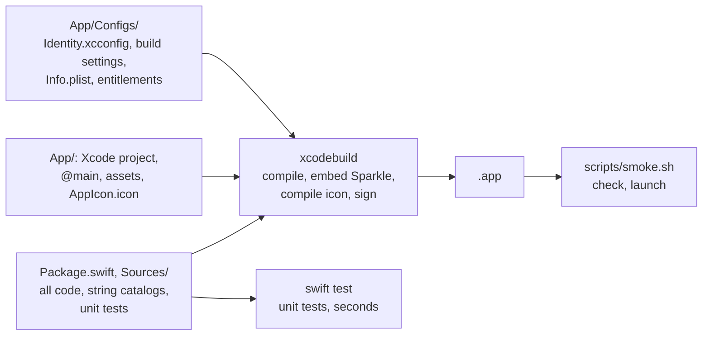

# Development

## Requirements

- Xcode 26 (Swift 6.2), selected with `xcode-select`. On macOS 26 or later, Xcode 26.3
  or later adds `xcrun mcpbridge`, through which coding agents build, test and render
  previews in Xcode. On macOS 15 it is installed but does not launch; `make doctor`
  says which case you are in.
- [lefthook](https://lefthook.dev) for git hooks: `brew install lefthook`
- The app runs on macOS 14 or later

```bash
make setup   # check the toolchain, install git hooks
make run     # build and launch the debug app
```

## How the app is built



Xcode builds the app the way it builds any app; `scripts/build-app.sh` only adds the
version from `version.txt` and, for releases, archives a universal build and signs it
with the Developer ID. `swift test` builds the package alone, without the app, which
keeps the unit-test loop fast.

## Commands

`make help` lists every target.

- `make test` runs the unit tests: seconds, no app, no UI. Run it after every change.
  It includes the snapshot tests, which compare views with the PNGs in `__Snapshots__/`
  and never record: a missing or changed reference fails.
- `make snapshots` records the missing and changed references. Look at each new image
  first; an agent shows you the old and the new one and asks before it runs this, and
  Claude Code asks too (`.claude/settings.json`). A PR that changes references fails
  the `Snapshot review` check until you compare the images in Files changed (2-up,
  swipe, onion skin) and add the `snapshots-reviewed` label; a later push that changes
  them again removes the label. References hold one macOS major's controls, so CI runs
  on the macOS major of the Mac that records them: init sets `runs-on` to this Mac's,
  and `make doctor` warns when the two drift apart, after a macOS upgrade for one. Then
  set `runs-on` in `ci.yml` and `release.yml` to the new major and re-record.
- `make ci` runs lint, the unit tests, the debug `.app` and its launch smoke test. It is
  the definition of done.
- `make test:ui` runs the UI tests. On a Mac they drive the real mouse and keyboard,
  so the app comes to the front and types while they run: leave the machine alone until
  they finish. GitHub CI runs them after `make ci`. The first run asks for an
  administrator password to turn on Automation Mode, unless you turn it on once with
  `sudo automationmodetool enable-automationmode-without-authentication`.

Try the Chinese UI with `make run ARGS="-AppleLanguages '(zh-Hans)'"`.

## Layout

`<App>` is the app's name (`APP_NAME`). Before the first release,
`scripts/rename.sh --name <Name> --bundle-id <id>` renames the app (name, display name,
bundle identifier) and the package, the Xcode project, its targets and the scheme.

```text
Package.swift              the package with all the code: targets, platforms, Swift
                           settings, Sparkle
Sources/AppRoot/           root model, scenes, menu commands
Sources/Features/<Name>/   one target per area of the app: its screens, model, string
                           catalog
Sources/Platform/Core/     protocols for what reaches outside the process, and mocks
Sources/Platform/Live/     the live implementations: system APIs, network, Sparkle
Sources/<Domain>/          the app's own domains, Core/ and Live/ as in Platform
Tests/                     Swift Testing, mirroring Sources/
App/                       the Xcode shell
  <App>.xcodeproj/         <App> and <App>UITests targets, shared <App> scheme
  Application/             @main (composition root), app delegate, assets, AppIcon.icon,
                           privacy manifest
  UITests/                 XCUITest: a few critical flows
  Configs/                 Identity.xcconfig (app identity), build settings, Info.plist,
                           entitlements
  Package.swift            empty: keeps App/ out of the root package in Xcode
scripts/                   build, sign, notarize, package, publish, lint rules
.agents/skills/            agent skills, linked from .claude/skills
.github/                   CI, PR title, release-please, Dependabot, templates
version.txt                current version, owned by release-please
```

Where code goes and the rules it follows: [AGENTS.md](../AGENTS.md); why, with a menu bar
monitor as the example: [ARCHITECTURE.md](ARCHITECTURE.md).

## Editors

- Xcode: `xed App/<App>.xcodeproj`. Its Run button builds and launches the real `.app`
  (bundle identifier, sandbox, Info.plist), with the debugger attached. Previews run
  in the package targets. `xed .` opens the package alone, without the app.
- VS Code, Cursor, Zed: the Swift extension (sourcekit-lsp) loads the package at the
  root; the files in `App/` get no code intelligence. Build and run the app with
  `make run`.

## Agent skills

Skills live in `.agents/skills` (Codex and other agents), linked from `.claude/skills`
(Claude Code).

- `app-icon`: the app icon, from your logo or image, as drawn layers, or through an
  image-model prompt; it renders every appearance and sets the icon beside installed
  apps. Agents start it when you ask for an icon.
- `dmg`: designs the DMG window, from plain to a branded illustration, and wires
  dmgbuild into the build when you start it. Only you start it: `/dmg` in Claude Code,
  `$dmg` in Codex.
- `mac-app-store`: adds a Mac App Store build, beside the Sparkle release or instead of
  it, and wires it into the build and the code. Only you start it.
- `homebrew-cask`: puts the app on Homebrew: in the official `homebrew/cask`, which
  needs a Developer ID and a notable repository and then updates the cask by itself, or
  in your own tap, which every release updates and which also takes ad-hoc builds. Only
  you start it.

## Commits and releases

PR titles are Conventional Commits ([CONTRIBUTING](../.github/CONTRIBUTING.md)); PRs are
squash-merged, and release-please turns `feat` and `fix` into releases. The flow and the
one-time setup: [RELEASING.md](RELEASING.md). Recipes for launch at login, networking,
menu bar apps, global keyboard shortcuts and crash reporting: [RECIPES.md](RECIPES.md).
