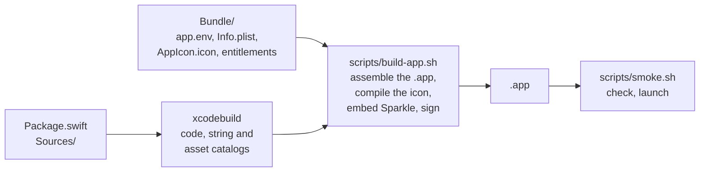

# Development

## Requirements

- Xcode 26 (Swift 6.2), selected with `xcode-select`
- [lefthook](https://lefthook.dev) for git hooks: `brew install lefthook`
- The app runs on macOS 14 or later

```bash
make setup   # check the toolchain, install git hooks
make run     # build and launch the debug app
```

## How the app is built



`swift build` copies the catalogs uncompiled, and its `Bundle.module` looks outside
`Contents/Resources`, so its output is never an app; use it only for quick compile
checks. `make app` and `make release` run the whole chain.

## Commands

`make help` lists every target. `make ci` runs everything CI runs; it is the definition
of done.

Try the Chinese UI with `make run ARGS="-AppleLanguages '(zh-Hans)'"`.

## Layout

```text
Package.swift              targets, platforms, Swift settings, Sparkle
Sources/App/               @main, scenes, commands, app delegate, updater
Sources/AppCore/           views, models, services, Localizable.xcstrings
Tests/AppCoreTests/        Swift Testing
Bundle/                    app.env, Info.plist, entitlements, privacy manifest, AppIcon.icon
scripts/                   build, sign, notarize, package, publish
.agents/skills/            agent skills, linked from .claude/skills
.github/                   CI, PR title, release-please, Dependabot, templates
version.txt                current version, owned by release-please
```

Where code goes and the rules it follows: [AGENTS.md](../AGENTS.md).

## Editors

- Xcode: `xed .` opens `Package.swift`. Its Run button starts the bare executable,
  outside an `.app`: no bundle identifier, no sandbox, no Info.plist. Use it for quick
  UI checks and SwiftUI previews; for the real app run `make run` and attach the
  debugger (Debug › Attach to Process, or `lldb -n <AppName>`).
- VS Code / Cursor: the Swift extension (sourcekit-lsp) works on the package as is.

## Agent skills

Skills live in `.agents/skills` (Codex and other agents), linked from `.claude/skills`
(Claude Code).

- `app-icon`: the app icon, from your logo or image, as drawn layers, or through an
  image-model prompt; it renders every appearance and sets the icon beside installed
  apps. Agents start it when you ask for an icon.
- `dmg`: designs the DMG window, from plain to a branded illustration, and wires
  dmgbuild into the build when you start it. Only you start it: `/dmg` in Claude Code,
  `$dmg` in Codex.
- `mac-app-store`: adds a Mac App Store build, beside the Sparkle release or instead of
  it, and wires it into the build and the code. Only you start it.
- `homebrew-cask`: publishes each release to your Homebrew tap, with a plain cask for a
  Developer ID and a choice of two for ad-hoc builds. Only you start it.

## Commits and releases

PR titles are Conventional Commits ([CONTRIBUTING](../.github/CONTRIBUTING.md)); PRs are
squash-merged, and release-please turns `feat` and `fix` into releases. The flow and the
one-time setup: [RELEASING.md](RELEASING.md). Recipes for launch at login, networking,
menu bar apps and crash reporting: [RECIPES.md](RECIPES.md).
