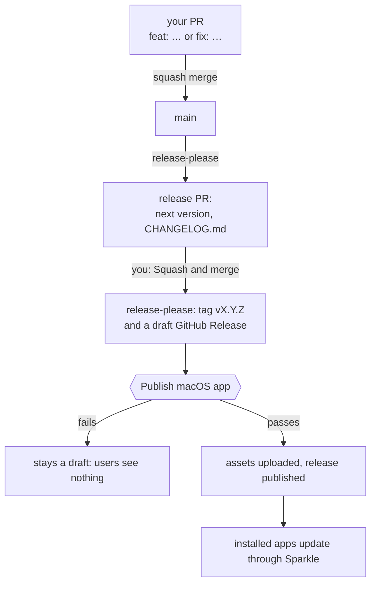
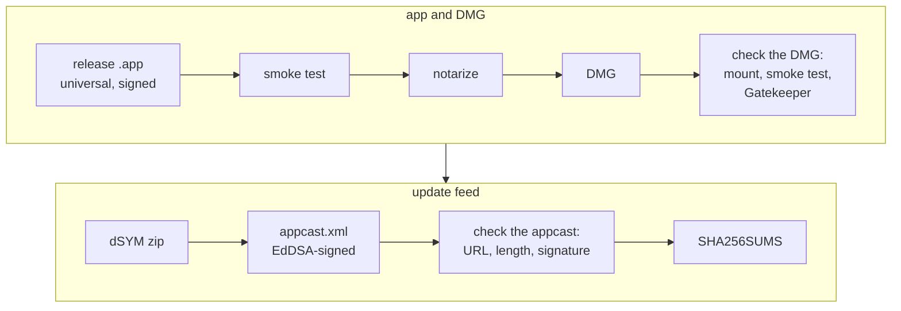
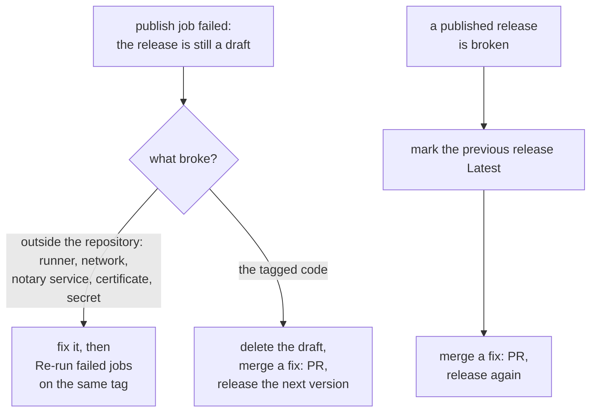

# Releasing

## How a release happens



- **Versions.** `feat` bumps the minor version and `fix` the patch; below 1.0 a breaking
  change bumps the minor version, not the major (`bump-minor-pre-major`). `chore`,
  `docs`, `ci` and the like release nothing. release-please writes the version to
  `version.txt` and `.release-please-manifest.json`. `CFBundleShortVersionString` comes
  from `version.txt`; `CFBundleVersion` is `git rev-list --count HEAD`, which only grows
  on `main` and is what Sparkle compares.
- **Draft release.** Nobody sees it, and `releases/latest` keeps pointing at the
  previous version, until the publish job has uploaded every asset. The release-only
  steps (universal build, notarization, DMG, appcast) first run in that job; when one
  fails, the release stays a draft ([Recovering](#recovering-from-a-failed-or-bad-release)).

The publish job checks out the tag and runs `make lint test`, then `make release`:



Notarizing, signing the DMG and the Gatekeeper check need a Developer ID; without one
they are skipped. The appcast check uses `SUPublicEDKey` in `App/Configs/Info.plist`, the key
installed apps trust. The job then uploads the DMG, dSYM zip, appcast and `SHA256SUMS` to the draft
release and publishes it, and keeps the dSYM as a workflow artifact for 90 days.
Installed apps read `releases/latest/download/appcast.xml`.

## One-time setup

Run these once per repository, after the first push of `main`.

### 1. Repository settings

```bash
make github-setup
```

Squash merge only, with the PR title as the commit title; `main` requires a PR and the
three checks below; the workflow token is read-only; the `release` environment only runs
from protected branches; private vulnerability reporting is on. The script prints the
settings it reads back.

| Required check | Your PRs | Release PR |
| --- | --- | --- |
| `Validate PR title` | runs | skipped |
| `Lint, test, build` | runs | skipped |
| `Snapshot review` | runs | runs, passes |

A skipped required check counts as passed. release-please's PRs (branch
`release-please--*` in this repository) change only the version and the changelog, so
they skip the first two and change no snapshot. `Snapshot review` fails while a PR
changes view snapshot references without the `snapshots-reviewed` label, which the
script creates; see [DEVELOPMENT.md](DEVELOPMENT.md#commands).

### 2. GitHub App for release-please

A PR opened with the default `GITHUB_TOKEN` starts no workflows, so its required
checks never report and it can never merge. release-please therefore runs on a
GitHub App token.

1. GitHub → Settings → Developer settings → GitHub Apps → New GitHub App. Webhook off.
   Repository permissions: Contents read and write, Pull requests read and write.
2. Generate a private key, then install the App on this repository.
3. Store its client ID and key:

   ```bash
   gh variable set RELEASE_APP_CLIENT_ID --body "<client id>"
   gh secret set RELEASE_APP_PRIVATE_KEY --env release < release-app.private-key.pem
   ```

The key writes to every repository the App is installed on, so give each repository
its own App, or install one App only on repositories with the same maintainers.

### 3. Sparkle signing key

```bash
make sparkle-keys
```

Creates an EdDSA key in your login keychain (account = bundle identifier), writes the
public key to `SUPublicEDKey` in `App/Configs/Info.plist` (commit it) and prints the two commands that export the
private key and store it as the `SPARKLE_ED_PRIVATE_KEY` secret of the `release`
environment. Back the private key up offline: without it, installed copies can never
update again. Release builds fail while `SUPublicEDKey` is empty.

### 4a. Without a Developer ID (default)

Leave `TEAM_ID` empty in `App/Configs/Identity.xcconfig`. Releases are ad-hoc signed, without the
hardened runtime (its library validation would reject the embedded Sparkle framework)
and without notarization. The publish job adds a note to the release explaining the
first launch.

| What users get | Ad-hoc (default) | Developer ID (4b) |
| --- | --- | --- |
| First launch | Blocked by Gatekeeper, once: System Settings → Privacy & Security → **Open Anyway** | Opens |
| Updates through Sparkle | Work: EdDSA proves they came from you, and no Gatekeeper prompt | Work |
| Permissions (camera, screen recording, accessibility…) and keychain items | May be asked for again after an update: every build has a new signature | Kept |
| Homebrew cask (`homebrew-cask` skill) | Own tap only: blocked at first launch, or the cask clears the quarantine flag; you pick, and README.md says so | Installs, and can go to the official `homebrew/cask` |

### 4b. With a Developer ID

1. Join the Apple Developer Program. Create a **Developer ID Application** certificate
   (Xcode → Settings → Accounts → Manage Certificates, as Account Holder) and export it
   with its private key from Keychain Access as a `.p12`.
2. App Store Connect → Users and Access → Integrations → App Store Connect API: create a
   team key with the Developer role; download the `.p8` once; note the key ID and the
   issuer ID.
3. Set `TEAM_ID` in `App/Configs/Identity.xcconfig` and commit.
4. Store the secrets in the `release` environment:

   ```bash
   base64 -i developer-id.p12 | gh secret set DEVELOPER_ID_P12_BASE64 --env release
   gh secret set DEVELOPER_ID_P12_PASSWORD --env release
   base64 -i AuthKey_XXXXXXXXXX.p8 | gh secret set NOTARY_API_KEY_P8_BASE64 --env release
   gh secret set NOTARY_API_KEY_ID --env release --body XXXXXXXXXX
   gh secret set NOTARY_API_ISSUER_ID --env release --body <issuer uuid>
   ```

   Then delete the exported files. The publish job imports them into a temporary
   keychain and deletes it when the job ends.
5. For local releases, keep the certificate in your login keychain and store notary
   credentials once:

   ```bash
   xcrun notarytool store-credentials notary --key AuthKey_XXXXXXXXXX.p8 \
     --key-id XXXXXXXXXX --issuer <issuer uuid>
   NOTARY_PROFILE=notary make release
   ```

With `TEAM_ID` set, a missing certificate or notary secret fails the release instead
of falling back to ad-hoc.

Check a notarized build:

```bash
spctl --assess --type execute -vv dist/<App>.app          # source=Notarized Developer ID
spctl -a -t open --context context:primary-signature -vv dist/<App>-X.Y.Z.dmg
xcrun stapler validate dist/<App>-X.Y.Z.dmg
```

Moving from ad-hoc to Developer ID keeps the same Sparkle key, so existing installs
accept the first Developer ID update by its EdDSA signature. This transition has not
been exercised yet; try it with a test build before relying on it.

## Recovering from a failed or bad release



While the release is a draft, users see nothing and Sparkle keeps offering the previous
version; read the job log to tell the two causes apart. A tag cannot move, so a code fix
ships as the next version, and the skipped version keeps its tag and its `CHANGELOG.md`
section. Marking the previous release **Latest** (edit release → Set as the latest
release) makes `releases/latest/download/appcast.xml` serve the previous appcast, so
Sparkle stops offering the broken update until the fix is out. Never move or delete a
published tag.

## Symbolicating crashes

Each release carries `<App>-X.Y.Z.dSYM.zip` (also kept as a workflow artifact for 90
days). Open source projects can leave it on the release; for closed source, remove the
asset upload in `scripts/publish-github.sh` and rely on the private workflow artifact.

```bash
atos -o <App>.app.dSYM/Contents/Resources/DWARF/<App> -arch arm64 -l <load address> <address>
```

## Homebrew cask (optional)

The `homebrew-cask` skill puts the app on Homebrew. The official `homebrew/cask` takes
apps with a Developer ID from notable repositories and updates the cask by itself; your
own tap takes any build, and every release updates it. Only you start it:
`/homebrew-cask` in Claude Code, `$homebrew-cask` in Codex.

## Mac App Store (optional)

The `mac-app-store` skill adds an App Store build, beside this release or instead of
it. Only you start it: `/mac-app-store` in Claude Code, `$mac-app-store` in Codex.

## Beta channel (optional)

Not wired by default. When testers need builds ahead of `main` releases:

1. Release prereleases from a branch with its own release-please config
   (`"prerelease": true`, `"versioning": "prerelease"`, `"prerelease-type": "beta"`)
   and `target-branch` on the action.
2. GitHub never marks a prerelease as latest, so the default feed ignores it. Publish
   a second appcast for betas with `generate_appcast --channel beta`, and let testers
   opt in through `SPUUpdaterDelegate.allowedChannels(for:)` behind a setting.
