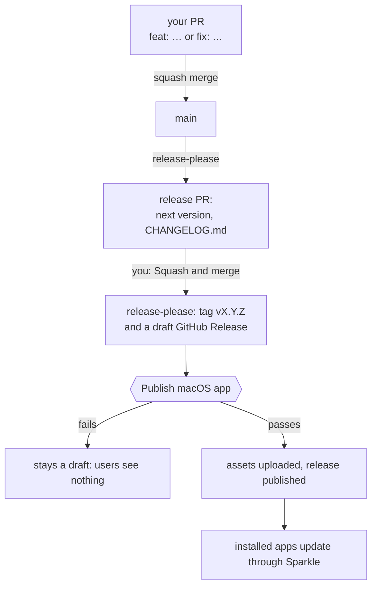
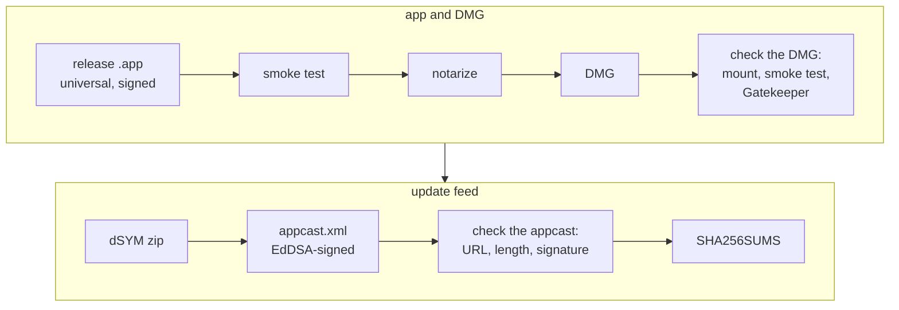
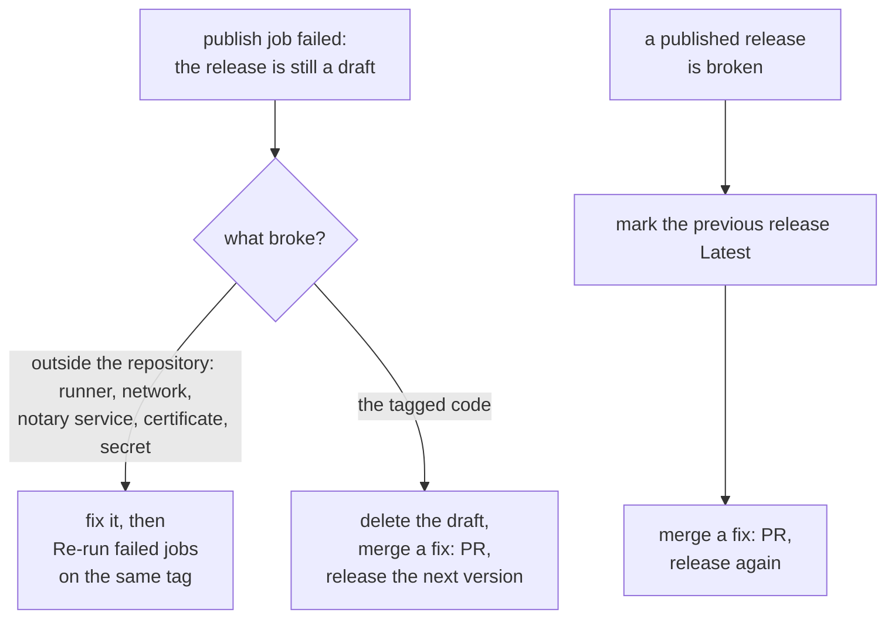

# Releasing

## How a release happens



- **Versions.** `feat` bumps the minor version, `fix` the patch, a breaking change below
  1.0 the minor (`bump-minor-pre-major`); `chore`, `docs`, `ci` release nothing.
  release-please writes `version.txt` (`CFBundleShortVersionString`) and the manifest;
  `CFBundleVersion` is `git rev-list --count HEAD`, which only grows on `main` and is
  what Sparkle compares.
- **Dependencies.** Dependabot opens only security updates (`.github/dependabot.yml`),
  whose `fix` prefix makes a release; a routine bump would release a patch with nothing
  in it. Bump a package by hand as `chore(deps)`, or as `fix(deps)` to release it.
- **Draft release.** Nobody sees it, and `releases/latest` keeps pointing at the
  previous version, until the publish job has uploaded every asset. The release-only
  steps (universal build, notarization, DMG, appcast) first run in that job; when one
  fails, the release stays a draft ([Recovering](#recovering-from-a-failed-or-bad-release)).

The publish job checks out the tag and runs `make lint test`, then `make release`:



Notarizing, signing the DMG and the Gatekeeper check need a Developer ID; without one
they are skipped. The appcast check uses `SUPublicEDKey` in `App/Configs/Info.plist`, the
key installed apps trust. The job uploads the DMG, dSYM zip, appcast and `SHA256SUMS`,
publishes the release and keeps the dSYM as a 90-day workflow artifact. Installed apps
read `releases/latest/download/appcast.xml`.

## Setup

A repository needs a one-time setup before its first release; until then the Release
workflow skips with a notice. The `release-setup` skill walks you through it
(`/release-setup` in Claude Code, `$release-setup` in Codex).

## Recovering from a failed or bad release



While the release is a draft, users see nothing and Sparkle keeps offering the previous
version; read the job log to tell the two causes apart. A tag cannot move, so a code fix
ships as the next version, and the skipped version keeps its tag and its `CHANGELOG.md`
section. Marking the previous release **Latest** (edit release → Set as the latest
release) makes `releases/latest/download/appcast.xml` serve the previous appcast, so
Sparkle stops offering the broken update until the fix is out. Never move or delete a
published tag.

## Symbolicating crashes

Each release carries `<App>-X.Y.Z.dSYM.zip` (also kept as a workflow artifact for 90
days). Open source projects can leave it on the release; for closed source, remove the
asset upload in `scripts/publish-github.sh` and rely on the private workflow artifact.

```bash
atos -o <App>.app.dSYM/Contents/Resources/DWARF/<App> -arch arm64 -l <load address> <address>
```

## Homebrew cask (optional)

The `homebrew-cask` skill puts the app on Homebrew. The official `homebrew/cask` takes
apps with a Developer ID from notable repositories and updates the cask by itself; your
own tap takes any build, and every release updates it. Only you start it:
`/homebrew-cask` in Claude Code, `$homebrew-cask` in Codex.

## Mac App Store (optional)

The `mac-app-store` skill adds an App Store build, beside this release or instead of
it. Only you start it: `/mac-app-store` in Claude Code, `$mac-app-store` in Codex.

## Beta channel (optional)

Not wired by default; publish betas on a separate appcast channel as
[Sparkle channels](https://sparkle-project.org/documentation/publishing/#channels) describes.
