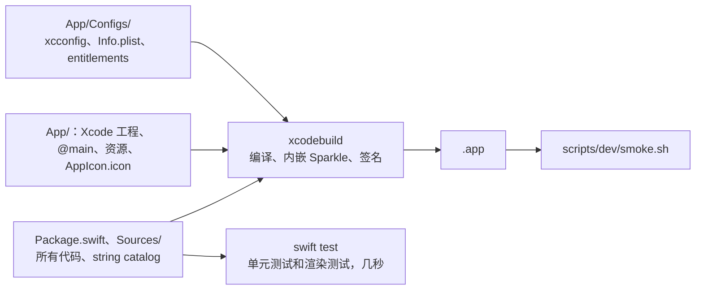
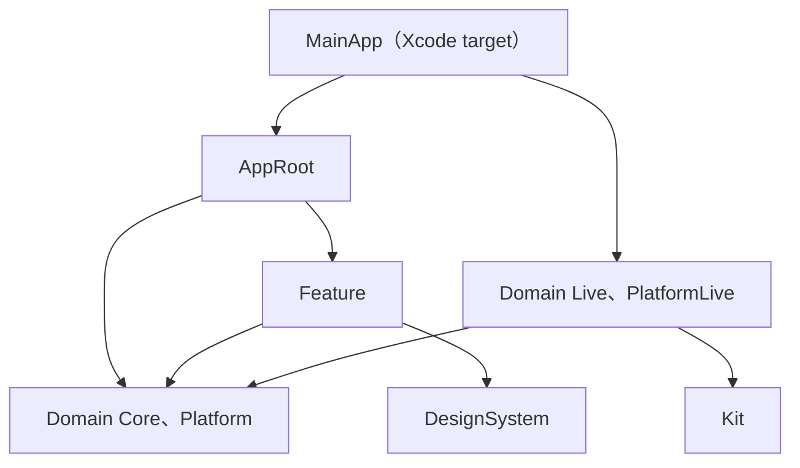
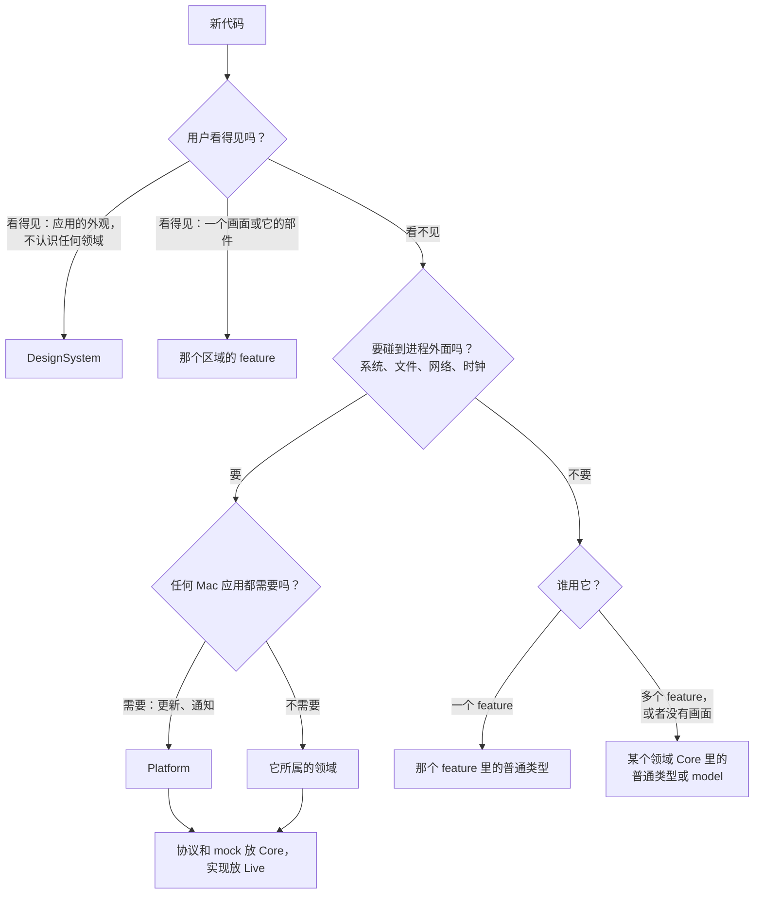

# 架构

代码为什么这样拆。要遵守的规则写在
[Sources/AGENTS.md](../../Sources/AGENTS.md) 和 [App/AGENTS.md](../../App/AGENTS.md) 里；
这一页给的是理由。

## 应用是怎么构建出来的

| 为什么 | 因为 |
| --- | --- |
| 所有代码在一个 Swift 包里 | `swift test` 不用构建应用就能构建它，所以测试循环只要几秒；Xcode 以外的编辑器也看得懂 |
| 一个很薄的 Xcode 工程 | 只有 Xcode 会签名、内嵌框架、编译图标；设置放在 `App/Configs/*.xcconfig` 里，不在工程里 |
| `scripts/dev/build.sh` | 加上版本号和 commit 数；发版构建再加上一个用 Developer ID 签名的通用归档 |

## 分层

| 层 | 装什么 | 依赖谁 |
| --- | --- | --- |
| Feature | 用户干活的一块区域：各个画面和它们的 model | 领域 Core、Platform、DesignSystem |
| Domain Core | 进程外东西的协议、值类型、纯逻辑、mock | 别的 Core、kit |
| Domain Live | 一个 Core 的协议的真实实现 | 它自己的 Core、别的 Core、kit；永远不用别的 Live |
| Platform | 任何 Mac 应用都有的领域：更新、开机启动、通知 | 不依赖应用里的任何东西 |
| DesignSystem | 间距、圆角、字体、颜色、共享组件；不认识任何领域 | 不依赖应用里的任何东西 |
| Kit | 一个 C 或私有接口的封装，完全不认识这个应用 | 不依赖应用里的任何东西 |
| AppRoot | 根 model 和各个 scene | feature、Core |
| MainApp | 在 Xcode target 里：构建 Live 并交给 AppRoot | AppRoot、Live |

## 一条规则把它们串起来

live 实现只由 `MainApp` 构建，feature 看到的是协议。所以测试和 Preview 都跑在 mock 上，在别处
import 一个 Live target 会让 `make test` 失败。

## 这段代码放哪？

## 一个假设的例子：菜单栏监控

模板里没有这东西：一个想象出来的应用，规模正是这套结构面向的规模，一个把 CPU、内存和网络
显示在菜单栏、并在 CPU 持续偏高时发出告警的监控。`MainApp` 构建 `MonitorLive` 和
`PlatformLive`；`AppRoot` 持有 `MonitorFeature` 和 `SettingsFeature`；`Alerts` 依赖
`Monitor` 和 `Platform`。

| 问题 | 监控里的答案 | 为什么 |
| --- | --- | --- |
| 菜单栏标签、面板和总览显示同一份读数 | 一个 `MonitorFeature`，每个画面一个文件夹 | 它们一起变；分成三个 target，要声明、要接线的 target 就成了三倍 |
| 设置 | 自己的 `SettingsFeature` | 它随「能配置什么」变化，不随读数变化 |
| 点内存标签，面板里就选中内存 | 选中项放在 `MonitorModel` 里 | feature 的 model 持有各画面共享的东西；`AppModel` 只持有 feature 的 model 和全应用的服务 |
| 读 CPU | `Monitor` 里的 `CPUReader` 协议和 mock，`MonitorLive` 里的 `LiveCPUReader` | 测试喂录下来的 ticks；`CPUUsage.compute` 是普通函数，不用协议 |
| 「CPU 超过 90% 持续两分钟」就发通知 | `Alerts` 里的 `AlertRules`，它依赖 `Monitor` 和 `Platform` | 不放在 reader 里（每个传感器都要重复一遍），不放在画面里（只有显示时才跑），也不放在 `MainApp` 里（没有测试够得着） |
| 通过 SMC 读风扇 | `SMCKit`，由 `MonitorLive` 使用 | kit 不认识这个应用 |
| 一个小组件 | `App/` 里另一个薄 target，链接 `Monitor` 和它需要的 Live | 它用不了 feature，也用不了 `AppRoot` |

加内存要动 `Domains/Monitor/Memory/`、`Domains/MonitorLive/Memory/` 和一个面板，还有
`Sampler` 和 `MonitorModel`。`Package.swift`、Xcode 工程和 `AppModel` 都不动。

## 应用的外观

| 东西 | 放在哪 | 为什么 |
| --- | --- | --- |
| 应用自己定的间距、圆角、字体、颜色 | `DesignSystem` | 每个画面读到的是同一批值 |
| 共享组件（`StatusBadge`、`Sparkline`） | `DesignSystem`，不认识任何领域 | feature 把自己的类型映射到它们上面，所以领域一变它们不用重写 |
| 颜色 | 代码里：每个颜色一个 `NSColor(name:dynamicProvider:)` | `swift test` 拷贝 asset catalog 但不编译它，所以渲染图会画错 |
| 强调色 | 应用 asset catalog 里的 `AccentColor`，默认留空 | 只有用户的强调色是多色时系统才用它；`.tint` 会盖掉用户的选择 |
| 系统字体、间距、`Form` | 不做 token | 抄一份只会和 macOS 渐行渐远 |

## 暂不做

| 想法 | 为什么等 |
| --- | --- |
| 每个传感器或画面一个 target | 七个传感器变十四个 target，改一个新间隔要动其中一半 |
| 依赖注入容器 | 组装就是 `MainApp` 里的一个函数 |
| 拆成多个 Swift 包 | 版本和资源要在它们之间对齐；等到某个包构建太慢时才值得 |
| 还没有小组件就先建小组件 target | 一个空的 target 要构建、要签名 |
| 给纯逻辑加协议 | 纯函数直接测 |
| 给每个系统值一个 token | macOS 控件本来就有自己的字体和间距 |
