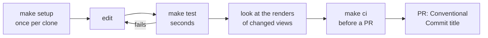

# 开发

日常循环、编辑器和命令，给做这个应用的人看。工具链：Xcode 26.2，即 CI 用的版本
（[TOOLCHAIN.md](TOOLCHAIN.md)）；`make doctor` 会检查它。

## 日常循环

1. `make setup` 一次：检查工具链，装好 git 钩子。
2. 每次改完都跑 `make test`。它的渲染测试把每个画面、明暗两套画到
   `.build/renders/<test file>/<test>.png`。没有谁去比对它们：打开你改过的那些视图的图片看。
3. 开 PR 之前跑 `make ci`。它就是「做完了」的定义。
4. 用 Conventional Commit 标题开 PR
   （[CONTRIBUTING](../../.github/CONTRIBUTING.md)）；它以 squash 合并。发布一个版本：
   [RELEASING.md](RELEASING.md)。

CI 会把它在 macOS 26 上画的那些渲染图作为这次运行的 `renders` artifact 上传：
`gh run download <run id> -n renders`。

## 命令

`make help` 列出入口；你天天用的是下面这些。`make build`、`make
smoke` 和 `make lint-assets` 是 `make ci` 的步骤，所以 `make help` 里没有它们；它们单独也能跑。

| 命令 | 做什么 | 什么时候 |
| --- | --- | --- |
| `make setup` | `make doctor`，然后装 git 钩子 | 每个 clone 一次 |
| `make doctor` | 检查 Xcode、工具和签名身份 | 构建莫名其妙失败时 |
| `make status` | 项目走到哪了，从模板到发版，下一步是什么 | 任何时候 |
| `make github-settings` | squash 合并、`main` 受保护、GitHub 上的 Dependabot 和 secret scanning | 第一次 push 之后；第二个人能 push 时 |
| `make test` | 包的单元测试和渲染测试，不构建应用 | 每次改完 |
| `make run` | 构建并启动 debug 版应用，日志打在终端里 | 想试一个改动 |
| `make fmt` | 就地格式化 Swift 源码 | 提交之前 |
| `make lint` | 格式化和 `scripts/dev/lint-rules.sh` | `make ci` 的一部分 |
| `make lint-assets` | 用 actool 编译 asset catalog 和 `AppIcon.icon`，任何警告都失败 | 改了图标之后；`make ci` 的一部分 |
| `make build` | 构建 debug 版 .app，ad-hoc 签名 | 想确认 app target 能构建 |
| `make ci` | lint、test、lint-assets、build、smoke | 开 PR 之前 |
| `make test-ui` | XCUITests；它们会接管鼠标键盘 | 别人要求时；CI 每次 PR 都跑 |
| `make clean` | 删掉构建产物 | 换工具链之后 |

| 任务 | 命令 |
| --- | --- |
| 用中文界面跑 | `make run ARGS="-AppleLanguages '(zh-Hans)'"` |
| 跑 UI 测试不弹密码框 | `sudo automationmodetool enable-automationmode-without-authentication`，一次 |

## 编辑器

| 编辑器 | 怎么配 | 备注 |
| --- | --- | --- |
| Xcode | `xed App/App.xcodeproj` | Run 构建真正的 `.app`，调试器接着；Preview 在包的 target 里跑 |
| Xcode，只开包 | `xed .` | 只有包，不带应用壳 |
| VS Code、Cursor、Zed | Swift 扩展（sourcekit-lsp） | 在根目录加载包；`App/` 拿不到代码智能，所以用 `make run` |

`<App>` 是应用的名字，即 `App/Configs/Identity.xcconfig` 里的 `APP_NAME`
（[App/AGENTS.md](../../App/AGENTS.md) 说每个 identity 键由谁设）。

## 代码放哪

文件放哪、依赖朝哪边指：[Sources/AGENTS.md](../../Sources/AGENTS.md)；
为什么：[ARCHITECTURE.md](ARCHITECTURE.md)。要加功能就跑 `make feature
NAME=<Area>`：它写下这个功能、它的测试和那些 target，然后打印把它接进去的那两行。
